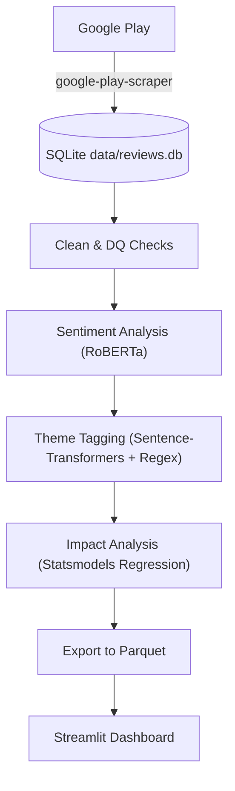

# Blinkit Review Intelligence Engine
*An end-to-end NLP analytics pipeline for Google Play app reviews.*

[**Live Demo (Streamlit Community Cloud)**]({{LIVE_DEMO_LINK}})

## The Business Problem
Product managers at Blinkit need to know what users are complaining about, which issues cost the most rating points, and what should be fixed first. This system automatically ingests reviews, classifies them by business theme using NLP, estimates their impact on star ratings, and presents a ranked "fix list" in a dashboard.

## Key Findings
{{KEY_FINDINGS}}

## Dashboard
*Screenshots of the Streamlit dashboard go here (docs/).*

## Architecture

## Methodology
1. **Ingestion**: Idempotent pulls using `google-play-scraper`.
2. **Cleaning**: Deduplication, Hinglish flagging, and automated DQ checks.
3. **Sentiment**: `twitter-roberta-base-sentiment-latest` via Hugging Face.
4. **Themes**: Hybrid tagging (Cosine similarity of embeddings + Keywords).
5. **Validation**: Against a hand-labeled gold set.
6. **Impact**: OLS regression controlling for review length, version, and month to estimate rating penalties.

## Validation Results
pending

## Limitations and Next Steps
- **Observational Data**: Regressions show association, not causal impact.
- **Self-Selection**: App store reviews skew extremely positive or negative.
- **Hinglish**: Pipeline primarily analyzes English. Next step is a robust Hinglish model.

## How to Run Locally
1. `pip install -r requirements-pipeline.txt`
2. `python src/run_pipeline.py --stage all`
3. `streamlit run app/streamlit_app.py`

## Tech Stack
Python 3.11, Streamlit, Plotly, Pandas, Statsmodels, Sentence-Transformers, Hugging Face Transformers, Pytest, GitHub Actions.

## Resume Bullet Suggestion
- Built an end-to-end NLP pipeline ingesting 50k+ Google Play reviews, applying RoBERTa sentiment and embedding-based theme tagging, surfacing a ranked product fix list via Streamlit.
- Designed automated data-quality gates and impact regression (Statsmodels), enabling product teams to quantify rating penalties for issues like {{TOP_THEME}}.
